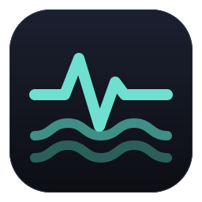
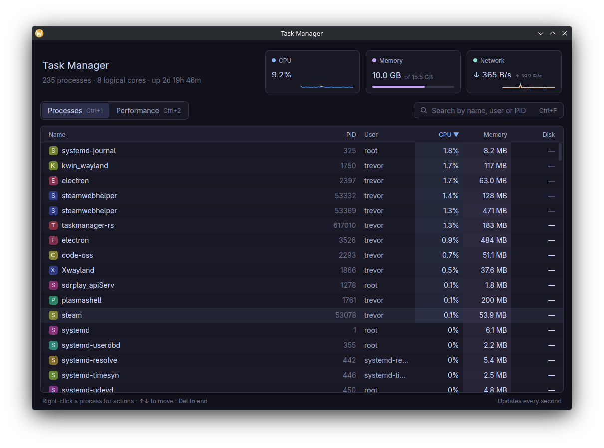
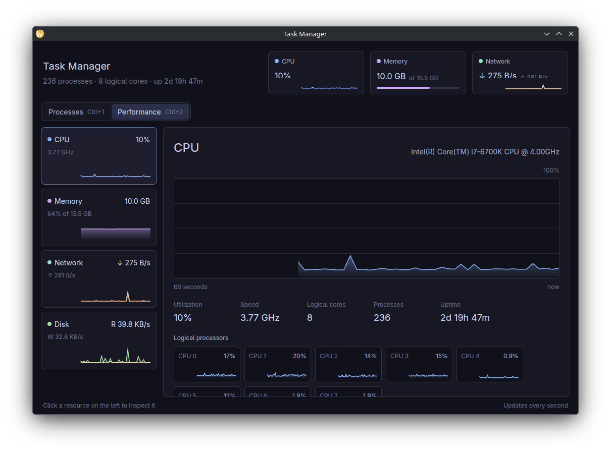

<p align="center">
  
</p>

<h1 align="center">Tidewatch</h1>

<p align="center">
  A fast, good-looking task manager for Linux.<br>
  Written in Rust on <a href="https://github.com/trevortomlin/gpui-fast">GPUI Fast</a>.
</p>

Tidewatch keeps an eye on the ebb and flow of your system: processes, CPU, memory, network and
disk. It's part of a family of fast Linux apps that share one look:
[Rowscope](https://github.com/trevortomlin/rowscope) (spreadsheets),
[Quarry](https://github.com/trevortomlin/quarry) (disk usage) and Warren (file manager).



<details>
<summary>Performance tab</summary>



</details>

## Features

- **Processes** — live, sortable, virtualized process table (name, PID, user, CPU, memory, disk) with heat-tinted cells for busy processes
- **Search** — filter by name, user, or PID prefix (`Ctrl+F`)
- **End processes** — right-click menu or keyboard: `Del` sends SIGTERM, `Shift+Del` sends SIGKILL
- **Performance** — 60-second graphs for CPU (overall and per core), memory and swap, network (per interface), and disk I/O
- **Network usage** — system-wide receive/send rates (virtual and loopback interfaces excluded)

## Keyboard shortcuts

| Key | Action |
| --- | --- |
| `Ctrl+1` / `Ctrl+2` | Processes / Performance tab |
| `Ctrl+F` | Focus search |
| `↑` / `↓` | Move selection |
| `Del` / `Shift+Del` | End / force-kill selected process |
| `Esc` | Close menu, clear search |
| `Ctrl+Q` | Quit |

## Building

Requires a recent stable Rust toolchain and the usual GPUI Linux dependencies (Vulkan, Wayland and/or X11, xkbcommon, fontconfig).

```sh
cargo build --release
./target/release/tidewatch
```

GPUI Fast is pulled from [its repository](https://github.com/trevortomlin/gpui-fast) at a pinned commit, so the first build takes a few minutes. Dependencies are optimized even in debug builds, so plain `cargo run` stays smooth while the app itself remains quick to recompile.

To add it to your application menu:

```sh
install -Dm755 target/release/tidewatch ~/.local/bin/tidewatch
install -Dm644 tidewatch.desktop ~/.local/share/applications/tidewatch.desktop
install -Dm644 assets/app/tidewatch.svg ~/.local/share/icons/hicolor/scalable/apps/tidewatch.svg
```

## Performance

The UI is built to hold the display's full refresh rate (tested at 165 Hz) while
scrolling and hovering:

- Sampling and all text formatting happen on a background thread; the UI thread only draws.
- Table rows are a single custom-painted element instead of nested layout boxes.
- Graph paths are cached and rebuilt only when their data or size changes.

To measure it on your machine, run the built-in frame benchmark with the window visible:

```sh
TIDEWATCH_BENCH=1 cargo run --release
```

It cycles through every view (including fast scrolling) and prints frame rate,
frame-interval and per-frame CPU percentiles, plus dropped frames, for each.

## Notes

- Per-process network usage isn't shown: Linux only exposes it to privileged tools.
- `src/text_input.rs` is adapted from gpui's `examples/input.rs` (Zed Industries, Apache-2.0).

## License

MIT — see [LICENSE](LICENSE). `src/text_input.rs` is derived from Apache-2.0 code from the Zed project; its notice is kept in that file.
